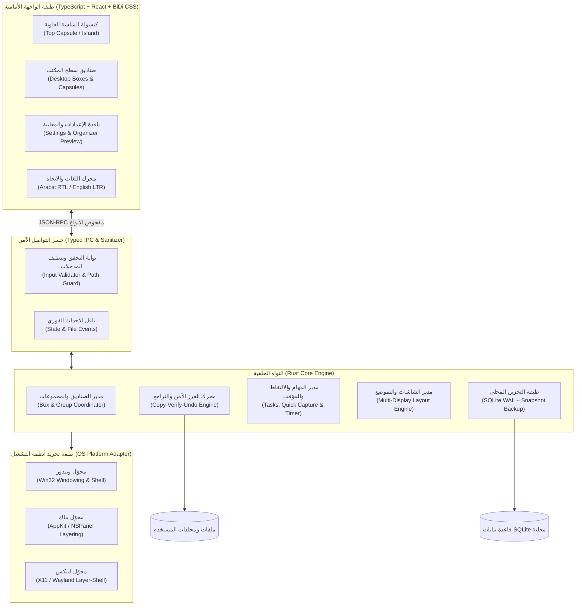
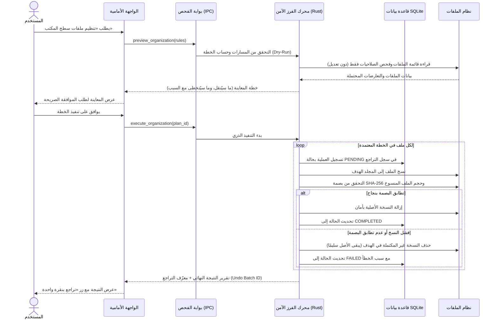

# المعمارية الهندسية للمشروع (System Architecture)

> **حالة الوثيقة:** ✅ معتمدة من مالك المشروع (2026-11-12)  
> **حالة التنفيذ والاختبار:** **«لم يُختبر»** (لم يُكتب أي كود بعد).

---

## 1. النظرة العامة على المعمارية (High-Level Architecture)

يتبنّى المشروع معمارية **متعددة الطبقات ومفصولة المسؤوليات (Layered Modular Architecture)** مبنية على إطار **Tauri v2** (نواة خلفية بلغة **Rust** + واجهة أمامية بـ **TypeScript / React**؛ راجع [ADR-0001](adr/0001-desktop-framework-and-languages.md)).

هذا الفصل يضمن أن:
- **كل منطق التعامل مع الملفات، قاعدة البيانات، والتكامل مع النظام** يقع داخل نواة Rust الآمنة والقابلة للاختبار المستقل (Headless Testing) على الأنظمة الثلاثة.
- **كل منطق العرض، التحريك، ودعم العربية (RTL) والإنجليزية (LTR)** يقع في طبقة الواجهة المعزولة التي لا تملك صلاحية وصول مباشر لنظام الملفات إلا عبر أوامر محدّدة ومفحوصة.



---

## 2. تفصيل أجزاء المشروع (Core Components)

### أولًا: النواة الخلفية (`Rust Core Engine`) — *«لم يُختبر»*

تُقسّم النواة الخلفية إلى وحدات (Crates / Modules) مستقلة يمكن اختبار كل منها بمعزل عن الواجهة الرسومية:

1. **`core-domain` (النماذج والقواعد المنطقية الصرفة):**
   - يحتوي على هياكل البيانات (`BoxItem`, `BoxGroup`, `OrganizeRule`, `TaskItem`, `CaptureNote`, `DisplayProfile`) وقواعد التحقق منها.
   - لا يعتمد على أي مكتبة نوافذ أو نظام تشغيل، مما يجعل اختباراته سريعة وحتمية 100%.

2. **`safe-organizer` (محرك الفرز الآمن وسجل التراجع):**
   - ينفّذ دورة حياة نقل الملفات الآمنة المستلهمة من `DeskBox`:
     1. **المعاينة (`Dry-Run Plan`):** حساب التغييرات المقترحة واكتشاف التعارضات (ملف موجود مسبقًا، نقص صلاحيات، ملف مقفول) دون تعديل أي بايت على القرص.
     2. **النسخ والتحقق (`Copy & Verify`):** نسخ الملف إلى الوجهة، والتحقق من تطابق الحجم وبصمة `SHA-256`.
     3. **التسجيل الذري (`Undo Journal`):** تسجيل العملية في جدول `file_operations_log` داخل `SQLite` قبل إزالة الملف من المسار القديم، مع إمكانية التراجع الكامل (`Rollback`).

3. **`storage-sqlite` (طبقة حفظ البيانات المحلية):**
   - تدير قاعدة بيانات `SQLite` بوضع `WAL` (Write-Ahead Logging) لضمان عدم تلف البيانات عند الإغلاق المفاجئ.
   - تحفظ إعدادات الصناديق، مواضعها لكل شاشة، المهام، الملاحظات الملتقطة، وسجل عمليات التراجع.
   - توفّر تصدير واستيراد نسخ احتياطية محلية موثّقة البصمة.

4. **`platform-adapter` (طبقة التوافق مع الأنظمة الثلاثة):**
   - واجهة موحّدة (`trait DesktopPlatform`) تُطبَّق لكل نظام تشغيل:
     - **Windows:** تثبيت الصناديق في طبقة سطح المكتب، واكتشاف وضع ملء الشاشة.
     - **macOS:** استخدام خصائص النوافذ العائمة غير المزعجة (`NSWindowLevel`)، ودعم شاشات Retina.
     - **Linux:** دعم `X11` و`Wayland` (مع الرجوع الآمن إلى نوافذ قياسية خفيفة إذا لم يدعم مدير النوافذ طبقة الخلفية).

---

### ثانيًا: جسر التواصل والأمان (`Typed IPC & Security Boundary`) — *«لم يُختبر»*

- كل طلب يمر من الواجهة الأمامية إلى النواة الخلفية يمر عبر **بوابة فحص (`CommandGate`)**:
  - **تنظيف المسارات (`Path Canonicalization & Scope Check`):** رفض أي مسار يحتوي على محاولات تجاوز (`..`) أو يشير إلى ملفات النظام الحساسة خارج نطاق المجلدات التي أذن بها المستخدم.
  - **تنظيف المدخلات النصية:** تطهير النصوص والروابط الملتقطة من الحافظة لمنع أي تنفيذ لشفرات خبيثة (`XSS`).

---

### ثالثًا: الواجهة الأمامية (`BiDi Frontend Layer`) — *«لم يُختبر»*

1. **نافذة كبسولة الشاشة العلوية (`Top Capsule Window`):**
   - نافذة شفافة الإطار في أعلى الشاشة، تعرض الحالة المصغّرة (المؤقت، الإشعار السريع، درج الملفات المؤقت)، وتتمدد بسلاسة عند التفاعل معها.
2. **نوافذ صناديق سطح المكتب (`Desktop Box Windows`):**
   - تعرض العناصر كشبكة أيقونات أو قائمة مدمجة، وتدعم الطيّ إلى كبسولة (`Capsule Mode`) والتبويب ضمن مجموعات (`Box Groups`).
3. **نافذة التحكم والمعاينة (`Control & Preview Window`):**
   - تُفتح عند الحاجة فقط (لتقليل استهلاك الذاكرة في الخلفية)، وتضم الإعدادات، معاينة الفرز الآلي، سجل التراجع، وإدارة الشاشات.
4. **نظام التصميم ثنائي الاتجاه (`BiDi Design System`):**
   - يعتمد كليًا على الخصائص المنطقية في CSS (`inline-start`, `inline-end`) لضمان تطابق التجربة بين العربية (`dir="rtl"`) والإنجليزية (`dir="ltr"`).

---

## 3. تدفق البيانات للعمليات الأساسية (Key Interaction Flows)

### تدفق عملية الفرز الآمن للملفات (Safe Organization Flow)



---

## 4. هيكل المجلدات المستهدف عند بدء كتابة الكود (Target Repository Layout)

> *ملاحظة: لن تُنشأ مجلدات الكود (`src-ui/` و`src-tauri/`) إلا في المرحلة الأولى بعد اعتماد ملفات الأساس الحالية.*

```text
/
├── .github/
│   ├── workflows/
│   │   ├── ci.yml                  # فحص وبناء واختبار تلقائي على Windows وmacOS وLinux
│   │   └── release.yml             # بناء الإصدارات آليًا من GitHub فقط عند دفع وسم v*
│   └── PULL_REQUEST_TEMPLATE.md    # قالب PR الإلزامي (يتضمن البرومبت والاختبارات)
├── docs/
│   ├── PRD.md                      # وثيقة متطلبات المنتج
│   ├── ARCHITECTURE.md             # المعمارية الهندسية
│   ├── ROADMAP.md                  # خارطة الطريق المرقّمة وشروط النجاح
│   └── adr/                        # سجل القرارات المعمارية (ADRs)
├── AGENTS.md                       # قواعد العمل الإلزامية للوكلاء والمطورين
├── README.md                       # تعريف المشروع وحالته
├── src-tauri/                      # (يُنشأ في المرحلة 1) النواة الخلفية بلغة Rust
└── src-ui/                         # (يُنشأ في المرحلة 1) الواجهة الأمامية بـ React/TypeScript
```
